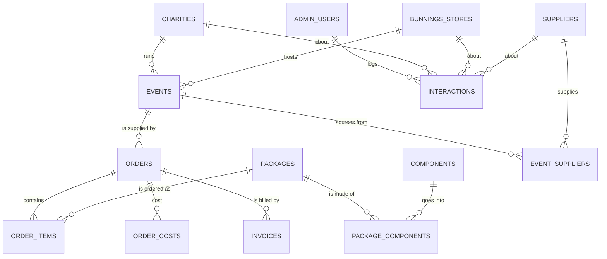

# Vision Velocity — review and build plan (as prompts)

**Copies.** Master: Claude Project `claude/improvement-plan-prompts-2026-10-25.md`. Copies: `VV App\Docs\improvement-plan-prompts-2026-10-25.md` and the code repository at `docs/plans/improvement-plan-prompts-2026-10-25.md` (for Claude sessions working in the repository). Edit the master; refresh the copies.

**Purpose.** A review of the Vision Velocity web app's **data structure**, **presentation** and **ease of use**, a range of suggestions to improve each, and a plan to build them with Claude, written as a series of copy-and-paste prompts.

**How this was checked (25 October 2026).**
- **Code:** every route, page and shared component listed in `04-development` was inventoried; the main pages, layouts, UI components, forms and back-end helpers were read. Working folder clean and level with GitHub `main` at `60b7286` (2 October).
- **Database:** table and column definitions, row counts and anonymous-access checks read through the Supabase REST interface with the back end's own key (read-only; nothing written). The Supabase connector in this session is linked to a different Supabase account and does not list the Vision Velocity project (see F6).
- **Live site:** public pages loaded at 390 px (phone) and 1366 px (computer) widths and inspected. Admin, charity and Bunnings officer pages could not be viewed signed in (Claude does not enter passwords on the production site), so those are judged from the code.

---

## 1. Summary

1. **The app is ahead of the business.** Since the 2 October build there have been no code changes, and the database still holds only test records: one test charity, one past test event, one inactive test package, one test component, **no orders and no invoices**. Invoice settings have no ABN, so no invoice can be issued. The last admin activity recorded on the site was 7 October; the one charity sign-in created (4 October) shows no sign-in since. Improvements should therefore make the **first real pilot work smoothly** rather than add features nobody has yet used.
2. **The public site makes claims the business cannot yet support** — a testimonial attributed to "the pilot program" (written as a placeholder during the build; no pilot results are recorded), Bronze/Gold/Platinum prices and features that the founders have not agreed, "proven" partnerships, visible placeholder text, and an **invisible main sign-up button** at the foot of the landing page. These should be fixed before any charity or Bunnings officer is sent the link.
3. **The data model splits one sizzle into two unconnected records.** An *event* (date, store, charity, packages used) and an *order* (date, charity, one package, delivery address, price, invoice) are entered separately and are not linked, so the same facts are typed twice and can disagree. Events have **no start or finish times**, orders have **no delivery time or delivery arrangements** (the 7 am delivery is the pilot's biggest stated risk), and there is **nowhere to record what each order cost** — which is the main thing the pilot is meant to find out.
4. **The admin site works but feels assembled rather than designed:** a flat twelve-item menu, no logo, each page building its own header, loading and error messages, buttons nested inside links, and a dashboard whose figures (for example "Bunnings stores: 310", all imported) do not help anyone decide what to do.
5. **Every change is still made and tested on the live system.** A separate staging site and database (free) would let Claude test signed-in pages itself, stop test emails reaching real charities, and make each prompt below safer.

The suggestions are in section 4; the decisions they need are in section 5; the prompts are in section 7.

---

## 2. Where things stand (evidence)

| Item | Finding | Source |
|---|---|---|
| Last code change | `60b7286` on 2 October (accessibility fixes). Working folder clean, level with `origin/main` | `git log`, `git status` on Mark's computer |
| Real records | `charities` 1 (test), `events` 1 (test, 1 October, completed, value of sales $250), `orders` 0, `invoices` 0, `packages` 1 (inactive "Test package #1"), `components` 1 ("Pork sausaga TEST"), `customer_interactions` 0, `leads` 0 | Live row counts |
| Imported reference data | `suppliers` 3,256 stores; `bunnings_stores` 310 stores | Live row counts |
| Invoice settings | Business name set; **ABN blank**; payment terms 14 days | `invoice_settings` |
| Site use | 81 usage records in all, much of it from build testing on 2 October; last admin activity 7 October; phone 41 and computer 40 | `usage_events` |
| Charity sign-in | One owner invited 4 October; never signed in | `charity_users` |
| Founders' daily summary | Sent 3–7 October; none since (it is sent only when something needs attention) | `automated_emails` |
| Public visits | 25 recorded (16 to the landing page); most recent 21 October | `page_views` |
| Anonymous access | No table returned rows to the public (anon) key | REST checks with the public key |

---

## 3. Review findings

### 3.1 Data structure

| # | Finding | Why it matters | Evidence |
|---|---|---|---|
| D1 | **Orders are not linked to events.** `orders` has its own `event_date` and `charity_id`; `events` has its own packages (`event_packages`). There is no `orders.event_id`. | The same sizzle is entered twice and the two can disagree (the run sheet reads event packages; the invoice reads the order). Reports cannot join cost, invoice and results for one sizzle. | Live schema; `components/forms/OrderForm.tsx` has no event field |
| D2 | **An order can hold only one package** (`orders.package_id`, single price). | Two packages, a top-up or a delivery fee cannot be invoiced as separate lines. | Live schema |
| D3 | **No times on events; no delivery details on orders.** `events` has a date only; the calendar file is all-day; orders have an address and contact but no delivery window, method, who delivers or when it was delivered. | Run sheets and calendar entries lack the start time; the 7 am delivery risk cannot be planned or tracked in the app. | Live schema; `lib/exporting.ts` writes `DTSTART;VALUE=DATE` |
| D4 | **No cost capture.** Nothing records what an order actually cost (goods, delivery, time). | The pilot's purpose, per the 16 September meeting and ROADMAP D2, is real cost and margin data to set the price. | Live schema; meeting notes |
| D5 | **"Awaiting approval" is stored as `trial`.** `charities.subscription_status` carries both the approval state and a future membership state. | Labels hide it, but reports and future membership pricing will collide with it (ROADMAP F3 notes the limitation). | Live schema; `lib/labels.ts` |
| D6 | **Public sign-up details go into free-text notes.** The requested first event (date, store, attendees) and the cause are written into `internal_notes`; postcode is not collected, although same-postcode and nearby matching depend on it. | Founders must retype the request as an event; nearby matching cannot place the charity. | `backend/app/api/public/charities/signup/route.ts` |
| D7 | **Charity address is one free-text field** (`location`), with a separate `postcode`; no suburb, state or organisation type. | Hard to filter, sort or check; inconsistent entries. | Live schema |
| D8 | **People are hard-coded.** `owner_person` is an enum of `rita` / `natalie` (used for "discovered by", "assigned to", "sent by"), and `supplier_contact.natalie_owner` is a true/false column. | Adding a staff member or volunteer needs a database change; Mark cannot be an owner. | Live schema |
| D9 | **Activity history covers charities only.** `customer_interactions.charity_id` is required, so store visits and calls with Bunnings officers or suppliers cannot be logged — the founders' first job (store visits) has no record type. | The CRM purpose of the app is only partly met. | Live schema; meeting action items |
| D10 | **Unused and duplicated structures.** `leads`, `email_campaigns`, `email_recipients`, `email_link_clicks` (all empty, no screens); `packages.items` (replaced by `package_components`); `charities.auth_user_id` (replaced by `charity_users`); `annual_membership_fee_paid` (pricing not settled); two "removed" flags on most tables (`is_active` and `is_deleted`) used inconsistently; older tables use database enums for statuses, newer ones free text with checks. | Confusing for anyone (or any Claude session) reading the model; risk of using the wrong field. | Live schema |
| D11 | **Dashboard figures are worked out in the browser.** "Revenue YTD" adds up at most 100 orders fetched by the page (and uses orders, not invoices); "Bunnings stores" counts all 310 imported stores. | Figures will be wrong or meaningless once real data arrives. | `app/admin/dashboard/page.tsx` |
| D12 | **The database cannot be rebuilt from the repository.** Only the four migration files from 1–3 October are in `database/migrations`; the original 15-table schema and the 30 September changes are not. Types are written by hand (`frontend/lib/types.ts`, 474 lines). | A staging copy or recovery depends on the live database; types can drift from the real columns. | Repository listing |
| D13 | **Nearby matching places charities at the average of store coordinates in their postcode** (`postcode_centroids`). A postcode with no stores cannot be placed. | Some charities will show exact-postcode matches only. | Events and same-postcode note, 30 September |

### 3.2 Presentation

| # | Finding | Why it matters | Evidence |
|---|---|---|---|
| P1 | **Testimonial presented as real.** "Sarah Thompson, Local Youth Sports Club, raised $3,500 in one weekend", footnoted "Testimonial from the Vision Velocity pilot program". It was built as a placeholder (ROADMAP F7) and no pilot results are recorded. | The ACCC treats fake reviews and testimonials as misleading under the Australian Consumer Law. It also undermines trust with charities and Bunnings. | Live landing page; `components/landing/Testimonial.tsx` |
| P2 | **Prices and features that are not decided.** Bronze $199, Gold $399 ("Most popular"), Platinum $699 with "24/7 event day support", "Thursday delivery", "up to 600 attendees", "post-event analytics". The 16 September meeting asked for **two packages at a flat price each**; the `packages` table (which the app uses for orders) is ignored by this section. | Charities may sign up expecting prices and services that do not exist. | `components/landing/PricingTiers.tsx`; meeting notes |
| P3 | **Unsupported claims and policies.** "proven and profitable", "Our supplier partnerships are established", "Join charities across Australia", "First event set up within 24 hours", landing FAQ answers such as "Most charities report…", "partnerships with Bunnings stores across Australia", "full refund up to 7 days before", "Your Vision Velocity dashboard tracks revenue, attendance…". Two different FAQ lists exist (landing page and `/public/faq`). | Promises the founders have not agreed; refund wording is a commitment. | Live landing page; `components/landing/FAQ.tsx`, `Benefits.tsx`, `Hero.tsx`, `CTAFooter.tsx` |
| P4 | **Placeholders visible to the public.** "[Hero image placeholder]" on the landing page; "Placeholder — About page content to be added." on About. | Looks unfinished. | Live pages |
| P5 | **Main sign-up button invisible.** "Get Started Today" on the dark closing panel shows as a blank white box: the button's own white text wins over the page's dark text class, because class names are joined without resolving conflicts. | The last call to action on the page does not read. | Screenshot at 390 px; `components/landing/CTAFooter.tsx`, `components/ui/Button.tsx` |
| P6 | **No logo, icon or social preview anywhere.** The header shows "Vision Velocity" as text; there is no favicon, phone home-screen icon or link-preview image; PDFs carry no logo. On phones the public header wraps to two lines of five links. | The brand (V + sunglasses mark) is absent; links shared in messages show no image. | `frontend` has no `public/` folder; `components/layouts/Header.tsx`; `backend/lib/pdf.ts` |
| P7 | **Flat admin menu.** Twelve items in one list (computer) and nine in the phone "More" sheet, with no grouping or icons. | Harder to scan; related pages (Packages and Components; Invoices and Invoice settings) are not together. | `components/layouts/AdminNav.tsx`, `components/ui/MobileNav.tsx` |
| P8 | **Buttons inside links** in about 19 places (`<Link><Button>`). | Not valid HTML (a link may not contain a button); keyboard users meet two focus stops. | `grep` of `frontend/app`, `frontend/components`; WHATWG HTML |
| P9 | **Each page builds its own furniture.** Headings, "Loading…" / "Checking…" text, red error lines, empty states and `window.confirm` pop-ups are hand-made per page; date formatting is re-written in five files although `lib/dates.ts` exists; no shared "saved" message. | Inconsistent look and wording; every new page repeats work. | Page sources |
| P10 | **The dashboard shows totals, not decisions.** Five number cards (one misleading, see D11) beside the useful "Needs attention" list. | Space on a phone is spent on figures nobody acts on. | `app/admin/dashboard/page.tsx` |
| P11 | **Long single-column record pages.** The event page stacks heading, checklist, details, three document panels, suppliers and supplier search; on a phone the actions are far down. Checklist hints say "Edit the event" rather than taking you there. | More scrolling and hunting on the founders' main device. | `app/admin/events/[id]/page.tsx`, `components/EventChecklist.tsx` |

### 3.3 Ease of use

| # | Finding | Why it matters | Evidence |
|---|---|---|---|
| E1 | **Double entry for each sizzle** (see D1): create the event, then create an order with the same charity and date. | Extra work and mismatches. | Code |
| E2 | **Finding suppliers for an event is a manual search**, although the app knows the store's coordinates and already works out distances for the side panel. | The commonest planning step takes several searches. | `app/admin/events/[id]/page.tsx`; `backend/lib/same-postcode.ts` |
| E3 | **Sign-up asks charities to pick from all 310 Bunnings stores in one drop-down** and does not ask for a postcode. | Slow on a phone; wrong store choices. | `components/SignupForm.tsx` |
| E4 | **Events list starts with everything**, past and future, with date and status filters only; no week grouping, calendar view or search by charity or store. | The question "what's on this week?" needs filtering every time. | `app/admin/events/page.tsx` |
| E5 | **Few tap-to-call or map links** (two `tel:` links in the whole admin site). | Founders on phones copy numbers by hand. | `grep` |
| E6 | **No bulk entry.** The founders' two seed lists (charities that run sizzles; officers' contacts from store visits) must be typed one record at a time; there is no "store visit" form. | Stage C of the roadmap depends on these lists. | Code; ROADMAP C3–C4 |
| E7 | **No "ready for the pilot" guide.** Missing ABN, no active package and leftover test records are not surfaced anywhere except by trying to issue an invoice. | First real order will stumble. | Live data |
| E8 | **No warning before leaving a half-filled form**, and no "who changed this and when" view on records (the audit trail exists in `audit_log`). | Lost work; questions about changes go to Mark. | `grep` (no `beforeunload`); live schema |
| E9 | **No sign that the ease-of-use build has been tried by its intended users.** Recorded use stopped on 7 October, and no project document records the user-testing round (script of 2 October) being run. | The best evidence for what to change next is still missing. | `usage_events`; user-testing script |

### 3.4 Foundations that affect all three

| # | Finding | Why it matters | Evidence |
|---|---|---|---|
| F1 | **No staging.** Changes are built, tested and deployed on production; staging was set to share the production database (30 September). | Test emails and test rows touch the live system; Claude cannot test signed-in pages without Mark. The Supabase Free plan allows two active projects, so a separate staging database costs nothing. | CHANGELOG 30 September, decision 3; Supabase pricing |
| F2 | **No automated tests** beyond lint, type check and build (CI). The accessibility check of 2 October was a one-off. | Regressions such as the invisible button (P5) go unnoticed. | `.github/workflows/ci.yml` |
| F3 | **Hosting terms and limits.** Vercel Hobby is for non-commercial, personal use only; Supabase Free pauses after 7 days of low activity and has no automated backups. Both were accepted as risks on 29 September "before any real charity uses the app". | Real charities' data and a business use need the paid plans. | Vercel and Supabase documentation; CHANGELOG 29 September |
| F4 | **Security items on hold** (29 September): admin roles not enforced, no security headers, in-memory rate limiter. | Acceptable for three founders; not once charities and officers sign in. | Security findings document |
| F5 | **Almost every page loads its data after it appears** (46 files under `frontend/app` are client components), hence "Loading…" flashes. | Minor for admins; the public pages could be fully static and faster. | Code |
| F6 | **Connectors.** The Supabase connector in this session does not list the Vision Velocity project, and the Vercel connector could not reach the VV team on 2 October. | Claude cannot apply migrations, run database advisers or confirm deployments itself; the prompts below rely on these. | This session; invoices note section 8 |

---

## 4. Suggestions

Priority: **Before pilot** = do before a real charity or officer uses the site; **Soon** = within the first weeks of the pilot; **Later** = once pilot evidence exists. Size: S (one session), M (one or two), L (two or three).

| # | Suggestion | Fixes | Priority | Size | Prompt |
|---|---|---|---|---|---|
| S1 | Reconnect Supabase and Vercel to the VV accounts; dump the full schema into the repository; generate database types; publish a plain-English data dictionary with a diagram | F6, D12 | Before pilot | S | 0.1 |
| S2 | Make the public site truthful: remove the testimonial and unsupported claims; show prices from the `packages` table (or "price on enquiry"); one FAQ source; real About text; no placeholders; fix the invisible button | P1–P5 | Before pilot | M | 1.1 |
| S3 | Separate Bunnings-facing page (agreed 16 September) | P3, meeting decision | Soon | S | 1.2 |
| S4 | Brand assets: logo in header and documents, favicon, phone icon, link-preview image, phone menu for the public header | P6 | Before pilot | S | 1.3 |
| S5 | Staging site and database (`staging.visionvelocity.com.au`), with email limited to test addresses | F1 | Before pilot | M | 0.2 |
| S6 | Automated checks in CI: public-page tests (no placeholder text, button contrast, no sideways scrolling on phones, accessibility rules), API access checks | F2, P5 | Before pilot | M | 0.3 |
| S7 | One sizzle, one record: link orders to events; order lines for several packages; "Create order from this event" | D1, D2, E1 | Before pilot | L | 2.1 |
| S8 | Event times; delivery window, method, who delivers and delivered time; times on run sheets and calendar files; "delivery not arranged" in Needs attention | D3 | Before pilot | M | 2.2 |
| S9 | Record actual costs and founder time per order; margin per order and a "Pilot economics" page with spreadsheet download | D4 | Before pilot | M | 2.3 |
| S10 | Charity record: explicit approval fields; structured address and organisation type; ABN check and optional ABN Lookup; sign-up collects postcode, suggests nearest stores and creates a requested event | D5–D7, E3 | Before pilot | L | 2.4 |
| S11 | Staff as people, not an enum; activity log for stores and suppliers (store visits, calls) | D8, D9 | Soon | M | 2.5 |
| S12 | Tidy unused tables and columns (only with Mark's approval); one convention for "archived"; dashboard figures worked out on the server from invoices | D10, D11 | Soon | M | 2.6 |
| S13 | Shared UI kit: conflict-free classes, link-styled buttons, page header, empty state, saved/error notices, confirm dialog, loading skeletons, contact links, one date helper | P8, P9, E5 | Before pilot | M | 3.1 |
| S14 | Grouped navigation with icons and logo; grouped phone "More" sheet | P7 | Soon | S | 3.2 |
| S15 | Event page redesign: summary header with next step, sections, actionable checklist, sticky phone actions; change history on records | P11, E8 | Soon | M | 3.3 |
| S16 | Dashboard redesign: "This week" timeline and figures that prompt action | P10, D11 | Soon | S | 3.4 |
| S17 | Events: upcoming/past views grouped by week, month calendar, search by charity or store | E4 | Soon | M | 4.1 |
| S18 | Nearest supplier stores suggested on each event with one-tap add | E2 | Soon | S | 4.2 |
| S19 | Spreadsheet import for charities and officer contacts; phone "store visit" form | E6 | Before pilot (if the lists exist) | M | 4.3 |
| S20 | "Ready for the pilot?" checklist on the dashboard; unsaved-changes warning on long forms | E7, E8 | Before pilot | S | 4.4 |
| S21 | Signed-in accessibility and keyboard checks on staging; person-led screen-reader check | F2 | Soon | S | 5.1 |
| S22 | Run the user-testing round with Rita, Natalie, two or three charities and one officer; turn findings into a fix list | E9 | Before pilot | M (people) | 5.2 |
| S23 | Go-live hardening: paid hosting plans, backups, error tracking, shared rate limiter, security headers, role enforcement | F3, F4 | Before real charities | M | 6.1 |
| S24 | Better postcode locations for nearby matching (research an open postcode-location source first) | D13 | Later | S | 6.2 |
| S25 | Make public pages static and faster | F5 | Later | S | 6.2 |

### What the core model would look like after S7–S11



---

## 5. Decisions needed before building

Each prompt stops and asks if its decision is not recorded. Suggested defaults are marked *Recommended*.

| # | Decision | Options | Needed by |
|---|---|---|---|
| Q1 | Prices on the public site until packages are agreed | (a) show active packages from the database, or "price on enquiry" if none — *Recommended*; (b) keep the current tiers | 1.1 |
| Q2 | Remove the testimonial and the unsupported claims listed in P3 | Yes — *Recommended* / keep some (name which) | 1.1 |
| Q3 | Who writes the About text and FAQ answers | Claude drafts from the overview and meeting notes, founders approve — *Recommended* | 1.1 |
| Q4 | Logo file for the site and documents | Supply the current V + sunglasses file now and replace it when the flat Core logo exists — *Recommended* | 1.3 |
| Q5 | Staging | Create a second free Supabase project and `staging.visionvelocity.com.au` — *Recommended* (Mark creates the project; Claude configures it) | 0.2 |
| Q6 | Orders and events | An event can have one or more orders; an order belongs to one event; event packages are replaced by order lines — *Recommended* | 2.1 |
| Q7 | Event times | Start and finish time required before an event is Confirmed — *Recommended* | 2.2 |
| Q8 | Cost categories for the pilot | Goods, delivery, packaging, equipment, other, plus founder minutes — *Recommended*; or your own list | 2.3 |
| Q9 | Charity approval | Move from `trial` to explicit approval fields (approved / declined, by whom, when) — *Recommended* | 2.4 |
| Q10 | ABN Lookup | Mark registers for the free ABN Lookup web services key so sign-up can fill in the charity's registered name — optional | 2.4 |
| Q11 | Unused tables and columns (D10) | Approve each removal separately after a backup; or keep and hide | 2.6 |
| Q12 | Hosting and security hold | Lift the 29 September hold and move to paid plans before the first real charity — *Recommended* | 6.1 |

---

## 5a. Who decides, and what can run before Rita and Natalie reply (9 November 2026)

Most of the twelve decisions are technical or data-model choices that Mark can make himself. Only three (prices, public wording, the About and FAQ text) and the user-testing sessions need Rita and Natalie.

### Who decides each question

| # | Decision | Who decides | Can Mark answer it now? |
|---|---|---|---|
| Q1 | Prices on the public site | Rita and Natalie (pilot packages and prices, roadmap C1) | No. An interim "price on enquiry" panel is in prompt 1.1a |
| Q2 | Remove the testimonial and unsupported claims | Removal: Mark, as an interim safety step. Replacement wording: Rita and Natalie | Removal only (prompt 1.1a) |
| Q3 | About text and FAQ answers | Rita and Natalie approve | No |
| Q4 | Logo file | Mark can supply the current production logo; the redrawn Core logo depends on the founders' brand decisions (roadmap C5) | Yes, if Mark has the current file |
| Q5 | Staging | Mark | Yes |
| Q6 | Orders and events | Mark | Yes |
| Q7 | Event times | Mark | Yes |
| Q8 | Cost categories | Mark sets the recommended list; founders can add types later (prompt 2.3 now stores them in a list, not a fixed set) | Yes |
| Q9 | Charity approval fields | Mark | Yes |
| Q10 | ABN Lookup key | Mark (optional) | Yes |
| Q11 | Unused tables and columns | Mark | Yes |
| Q12 | Hosting and security hold | Mark; spending on paid plans may need the founders' agreement | Yes for security headers and roles; paid plans at Mark's discretion |

### Prompts Mark can run now (suggested order)

| Order | Prompt | Mark's input needed |
|---|---|---|
| 1 | **0.1** Tools, schema, types, data dictionary | Reconnect the Supabase connector to the account that owns the Vision Velocity project (on 9 November it still listed only the Teacher Management project). The Vercel connector now reaches team VV |
| 2 | **0.2** Staging | Answer Q5; create the free Supabase project. The `staging` branch already exists (5 November) but shares the production database |
| 3 | **0.3** Automated checks | None |
| 4 | **1.1a** Interim public-site clean-up | Approve the removals (no new wording) |
| 5 | **3.1** Interface kit | None |
| 6 | **2.1**, **2.2**, **2.3**, **2.4** | Answer Q6, Q7, Q8 and Q9; Q10 optional |
| 7 | **2.5**, then **4.3**, **4.2**, **4.1** | None. 4.3 builds the import and store-visit tools; the founders' lists can be loaded whenever they exist |
| 8 | **4.4** Ready-for-the-pilot checklist | None |
| 9 | **3.2**, **3.3**, **2.6**, **3.4** | Answer Q11 (for 2.6) |
| 10 | **5.1** Accessibility, signed in | Mark runs the screen-reader check |
| 11 | **6.1** remaining technical items | Lift the hold on security headers and roles; confirm a Sentry test error; paid plans when Mark chooses |
| Any time | **6.2** Later improvements | Low priority |

### Prompts that can be prepared now and finished later

- **1.3 Brand assets:** run now with the current logo; replace it when the founders approve the redrawn Core logo.
- **1.2 Bunnings-facing page:** Claude can draft it now; publishing waits for Natalie (partnerships and marketing).
- **5.2 User testing:** steps 1 and 2 (packs, staging accounts) now; the sessions need Rita, Natalie, two or three charities and a Bunnings officer.
- **6.1 step 6, privacy notice:** draft now; approval by Rita (governance) with an adviser.

### Waiting on Rita and Natalie

- **1.1** full rewrite of the public pages (Q1, Q2 wording, Q3).
- **5.2** user-testing sessions.

**Caveat.** Prompts 2.3 (pilot economics) and 4.3 (imports and store visits) assume the app is the pilot's system of record (roadmap decision D7, recommended but still open). They remain useful either way, but are most valuable if the founders agree.

---

## 6. Working rules for every prompt

Each prompt below begins "Follow the working rules in section 6". A new Claude session attached to the Vision Velocity project, with the `VV App` folder connected, can read this document, so the rules are not repeated in every prompt.

1. **Read first:** `claude/INDEX.md`, the latest entries of `claude/CHANGELOG.md`, the relevant thread document, this document's findings cited by the prompt, and any document the prompt names. Documents archived on 30 October are in `claude/archive/` under the same names (for example `claude/archive/user-testing-script-2026-10-02.md`). Check whether the prompt's decision (sections 5 and 5a) is recorded; if not, ask Mark before building. Mirror every project document you create or change to `VV App\Docs\claude-project\` (see INDEX).
2. **Code and git:** the code is in `C:\Users\markj\OneDrive\Desktop\VV App\04-development` (GitHub `MJFellows/Vision-Velocity`, branch `main`). Its `.git` file points to `C:/Users/markj/vv-git/04-development.git`, so run git on Windows (PowerShell through Desktop Commander), not from the Linux shell. Before editing: `git status` clean and `git pull` level with `origin/main`. Production deploys `main` to Vercel (frontend `https://visionvelocity.com.au`, back end `https://api.visionvelocity.com.au`).
3. **Database:** Supabase project `kajhrbwxlzulqqissvwl` (Sydney). Every schema change goes in a dated file in `database/migrations/` and is applied to the live database (and to staging once it exists) through the Supabase connector; if the connector cannot see the project, stop and ask Mark to reconnect it. Run the Supabase security and performance advisers after each change. Back up a table before any destructive change, and never drop a table or column without Mark's explicit yes in the chat.
4. **Staging first** once prompt 0.2 is done: build on a branch, deploy to staging, test there (Claude may sign in to staging with test accounts it creates), then merge to `main`.
5. **Quality gates:** `npm run typecheck` and `npm run lint` in both apps (0 errors); `npm run build` in each app changed; the automated checks from prompt 0.3 once they exist.
6. **Test data:** clearly marked "TEST — DELETE ME", removed afterwards (decision D12). No email to real charities, officers or suppliers; test emails go to Mark's own address only.
7. **Production sign-in:** Claude does not type passwords on the production site. If a signed-in production check is needed, ask Mark to sign in in Chrome first.
8. **Close-out:** write a dated build note in the project (`claude/<topic>-<yyyy-mm-dd>.md`: what changed in plain language, decisions, database changes, checks done, what Mark must test, sources); add a CHANGELOG entry (newest first); update `claude/INDEX.md` and, after any schema change, `claude/data-model.md`; tick the prompt in section 8 of this document. British spelling, professional tone, sources listed as URLs at the end.
9. **Commit and deploy straight away** (project instruction): clear commit message, push to `main`, confirm both Vercel deployments are Ready, and do a live check of what changed.
10. **Stop and ask** when a step would affect real people's data, send a real email, spend money, or contradict a recorded decision.

---

## 7. The prompts

Recommended order: **0.1 → 1.1 → 0.2 → 0.3 → 1.3 → 3.1 → 2.1 → 2.2 → 2.3 → 2.4 → 4.4 → 5.2 → 6.1**, then the "Soon" items (1.2, 2.5, 2.6, 3.2, 3.3, 3.4, 4.1, 4.2, 4.3, 5.1), then "Later" (6.2). Prompt 1.1 is small and urgent and may run before staging exists. **Until Rita and Natalie reply, use the order in section 5a, with prompt 1.1a in place of 1.1.**

### Phase 0 — Foundations

#### Prompt 0.1 — Reconnect tools, rebuildable schema, types and data dictionary (S1)

```text
Follow the working rules in section 6 of claude/improvement-plan-prompts-2026-10-25.md.

Goal: make the Vision Velocity database fully described and rebuildable, and make sure you can reach it.

1. Check that the Supabase connector lists the project kajhrbwxlzulqqissvwl and that the Vercel connector can see the VV team (vision-velocity-frontend and vision-velocity-backend). If either cannot, stop and tell me exactly what to reconnect.
2. Produce a complete schema snapshot of the public schema (tables, columns, defaults, constraints, indexes, enums, views, functions, triggers, row-level security policies, pg_cron jobs and the Storage bucket component-images) and save it as database/migrations/00000000_baseline_2026-10-25.sql with a header saying it is a snapshot for rebuilding a fresh database, not to be run on production. Check it by applying it to an empty scratch database if one is available (staging comes later in prompt 0.2).
3. Generate TypeScript types for the database (supabase gen types typescript --project-id kajhrbwxlzulqqissvwl --schema public) into frontend/lib/database.types.ts and backend/lib/database.types.ts. Do not rewrite frontend/lib/types.ts yet; list in the build note where its hand-written types differ from the generated ones.
4. Write claude/data-model.md: a plain-English data dictionary (one section per table: purpose, each column in everyday words, allowed status values and what they mean, relationships), a Mermaid diagram of the main tables, and a short "known issues" list cross-referencing findings D1-D13 of the improvement plan.
5. Add an npm script "db:types" to both apps that regenerates the types, and note in the build note how to run it.
Acceptance: the baseline file exists and is complete; both apps still type-check and build; claude/data-model.md is listed in INDEX.md.
Close out per rule 8 and commit per rule 9.
```

#### Prompt 0.2 — Staging site and database (S5)

```text
Follow the working rules in section 6 of claude/improvement-plan-prompts-2026-10-25.md. Decision Q5 must be recorded as yes before you start.

Goal: a staging copy of Vision Velocity at https://staging.visionvelocity.com.au (frontend) and https://api-staging.visionvelocity.com.au (back end), with its own Supabase database, so that changes can be tested before production.

1. Ask me to create a second Supabase project (Free plan, Sydney region) in the Vision Velocity organisation and to connect it to the Supabase connector; I will tell you its project ref. Do not create accounts yourself.
2. Apply database/migrations/00000000_baseline_2026-10-25.sql, then any later migration files, to the staging project. Load reference data only (supplier_chains, component_units, the 310 Bunnings stores and 3,256 supplier stores, copied from production) plus clearly marked test records. No real charity or personal data.
3. In Vercel, create a long-lived branch "staging" for both projects; give the Preview environment of that branch its own variables (staging Supabase URL and keys, CLIENT_APP_URL and NEXT_PUBLIC_API_BASE_URL pointing at the staging hosts, a new JWT_SECRET, no CRON_SECRET). Assign the two staging hostnames to that branch. Show me the GoDaddy DNS records needed and add them with my approval.
4. Add an email allow-list to backend/lib/mailer.ts: when EMAIL_ALLOWLIST is set (staging), any recipient not on the list is logged and skipped. Set it to my address on staging. Make sure the founders' daily-summary cron cannot run on staging.
5. Set the staging Supabase Auth site URL and redirect URLs to the staging frontend, and copy the email templates from production.
6. Create staging test accounts for one admin, one charity user and one Bunnings officer email, with generated test passwords recorded only in a git-ignored file on my computer (04-development/e2e/.env.staging.local) for the automated checks in prompt 0.3 — never in project documents, the repository or the chat. Sign in to staging with them to check the admin, charity and officer areas load.
7. Update docs/DEPLOYMENT.md and claude/env-local-reference.md with the staging set-up and the new workflow (branch -> staging -> main).
Acceptance: both staging hosts load over HTTPS; signed-in admin, charity and officer pages work on staging; an email to a non-allow-listed address is skipped and logged; production is unchanged.
Close out per rule 8 and commit per rule 9.
```

#### Prompt 0.3 — Automated checks in CI (S6)

```text
Follow the working rules in section 6 of claude/improvement-plan-prompts-2026-10-25.md.

Goal: catch broken pages before they reach the public, using Playwright (already used by Claude for screenshots) and axe-core.

1. Add an e2e/ folder at the repository root with @playwright/test and @axe-core/playwright as dev dependencies, and a config that takes BASE_URL and API_URL from the environment.
2. Public tests (run at 390x844 and 1366x900): every public page loads with HTTP 200; no visible text matching "placeholder", "lorem" or "[...]"; no horizontal scrolling at phone width; every button and link has a visible name and at least 4.5:1 text contrast (axe rule `color-contrast`); axe WCAG 2.1 A/AA rules report no violations. Pages: /public/landing, /public/about, /public/faq, /charity/signup, /charity/login, /admin/login, /bunnings/activities-officer/sign-in.
3. API tests: admin, charity and officer routes return 401 without a token; /api/public/landing-page-data returns 200; CORS refuses a foreign origin.
4. Signed-in tests (staging only, skipped when no staging credentials are set): admin dashboard, events list, an event page, an order page; charity home and My events; officer events. Run axe on each.
5. Wire into .github/workflows: run the public and API tests on every pull request against its Vercel preview URL, and the full set against staging on pushes to the staging branch. Upload screenshots as build artefacts. Keep the existing smoke-test workflow.
6. Run the suite once against production now and report what fails (the invisible "Get Started Today" button and the placeholder text are expected to fail until prompt 1.1 is done; mark those two tests as known failures with a link to prompt 1.1 rather than deleting them).
Acceptance: the workflow runs green except the known failures; the build note lists every check.
Close out per rule 8 and commit per rule 9.
```

### Phase 1 — Public site credibility

#### Prompt 1.1 — Truthful, finished public pages (S2)

```text
Follow the working rules in section 6 of claude/improvement-plan-prompts-2026-10-25.md. Decisions Q1, Q2 and Q3 must be recorded before you change wording.

Goal: nothing on the public site claims more than Vision Velocity can deliver today, and nothing looks unfinished. Findings P1-P5.

1. Remove components/landing/Testimonial.tsx from the landing page. Leave a comment in the code that real, consented charity quotes can be added after the pilot.
2. Replace the hard-coded Bronze/Gold/Platinum tiers in components/landing/PricingTiers.tsx with the active rows of the packages table (via GET /api/public/landing-page-data, extended if needed: name, description, base price). If there are no active packages, show a short "Prices are confirmed when we talk about your event" panel with a contact button instead of prices. No "Most popular" badge unless the founders ask for one.
3. Rewrite the claims listed in finding P3 (Hero, Benefits, HowItWorks, CTAFooter, the landing FAQ) in plain, accurate words; draft them, show me the before and after side by side, and apply only what I approve. Do not state refund terms, response times, coverage ("across Australia") or partnerships unless I confirm them.
4. Use one FAQ source: move the questions and answers into one data file used by both the landing page and /public/faq, so the two cannot differ.
5. About page: draft content from claude/vision-velocity-overview.md and the brand draft (who the founders are, what Vision Velocity does, where it operates now), for my approval.
6. Hero: remove the placeholder block; use a real photograph only if the founders supply one with permission to use it, otherwise a simple text-only hero.
7. Fix the invisible "Get Started Today" button: add tailwind-merge and a cn() helper (lib/cn.ts), use it in components/ui/Button.tsx so a caller's colour classes override the variant's, and give the dark-panel buttons proper variants rather than overriding colours.
8. Add page titles and descriptions for each public page.
Acceptance: screenshots at 390 px and 1366 px of every public page (save them to VV App\Docs\screenshots\2026-10-25-public\); no placeholder text; the closing button reads clearly; the 0.3 checks (if present) pass.
Close out per rule 8 and commit per rule 9.
```

#### Prompt 1.1a — Interim public-site clean-up, before the founders' wording (S2, part)

Added 9 November 2026 for use while Q1–Q3 are unanswered. It removes and fixes; it writes no new claims. Prompt 1.1 later supplies the approved wording.

```text
Follow the working rules in section 6 of claude/improvement-plan-prompts-2026-10-25.md. Mark approves this interim clean-up; Rita and Natalie's decisions on prices and wording (Q1-Q3) come later in prompt 1.1.

Goal: until the founders decide prices and wording, the public site removes what Vision Velocity cannot yet support and adds no new claims. Findings P1, P2, P4, P5, and the parts of P3 that can simply be removed.

1. Remove the testimonial section (components/landing/Testimonial.tsx) from the landing page; keep the file with a comment pointing to prompt 1.1.
2. Pricing: replace the hard-coded Bronze/Gold/Platinum tiers in components/landing/PricingTiers.tsx with the active rows of the packages table (via GET /api/public/landing-page-data, extended if needed). While there are none, show "Prices are confirmed when we talk about your event" with a contact button. No prices, tier names or "Most popular" badge are typed into the code.
3. Remove, without rewriting, statements of partnerships, coverage ("across Australia"), "proven", response times ("within 24 hours"), refund terms, and a charity dashboard that tracks revenue: on the landing page (Hero, Benefits, HowItWorks, CTAFooter, FAQ), /public/faq, the sign-up form and the sign-up success page. Where a removal leaves a gap, use the plainest factual sentence already on the site. List every removed sentence, with its page, in the build note for Rita and Natalie to review in prompt 1.1.
4. Remove the hero placeholder block. Hide the About page from the header and footer until prompt 1.1 supplies approved text (unless Mark asks for a two-line factual description from claude/vision-velocity-overview.md instead).
5. Fix the invisible "Get Started Today" button: add tailwind-merge and lib/cn.ts, use cn() in components/ui/Button.tsx so a caller's classes override the variant's, and give the dark-panel buttons proper variants instead of colour overrides.
Acceptance: screenshots at 390 px and 1366 px of every public page saved to VV App\Docs\screenshots\<date>-public-interim\; no placeholder text; no prices or claims beyond what the database holds; the closing button reads clearly; the build note lists all removed text.
Close out per rule 8 and commit per rule 9.
```

#### Prompt 1.2 — Bunnings-facing page (S3)

```text
Follow the working rules in section 6 of claude/improvement-plan-prompts-2026-10-25.md.

Goal: the Bunnings-facing version of the landing content agreed at the 16 September meeting (claude/meeting-notes-2026-09-16-pricing-and-gtm.md).

1. Draft /public/bunnings for Activities Officers and store managers: what Vision Velocity does for charities at their store, what the officer sees in their area (events, run sheets without prices, contact details), how to get a sign-in link, and who to contact. Same visual system as the charity page; no prices; no claims the founders have not confirmed. Show me the draft before publishing.
2. Link it from the footer ("For Bunnings stores"), from /bunnings/activities-officer/sign-in, and from the officer sign-in email template.
3. Make the page printable as a one-page A4 handout (print stylesheet), since founders will hand it over on store visits.
Acceptance: page live, linked from the three places, prints on one A4 page, passes the 0.3 public checks.
Close out per rule 8 and commit per rule 9.
```

#### Prompt 1.3 — Brand assets (S4)

```text
Follow the working rules in section 6 of claude/improvement-plan-prompts-2026-10-25.md. Decision Q4 needed: ask me for the logo file (and where it is) before starting.

Goal: the Vision Velocity mark appears where people expect it. Finding P6.

1. From the logo file I give you, produce: a header logo (SVG preferred, otherwise PNG at 2x), favicon set and Apple touch icon, a 1200x630 link-preview (Open Graph) image with the logo on navy, and a small mono version for PDFs. Keep the source file untouched; save outputs to frontend/public/brand/ and to VV App\03-design\exports\.
2. Use the logo in the public header, admin sidebar, charity and officer area headers, sign-in pages and all emails (email-safe PNG with alt text).
3. Add the logo and a consistent header and footer (business name, ABN once set, contact address, page numbers) to every PDF made by backend/lib/pdf.ts and documents.ts (order summary, invoice, run sheet, results summary, supplier sheet).
4. Public header on phones: logo plus a menu button that opens the five links in a panel (keyboard and screen-reader friendly), instead of two wrapped lines.
5. Add metadata (Open Graph and Twitter card) so links shared in messages show the preview image.
Acceptance: screenshots of header (phone and computer), a sample of each PDF, and a link-preview check; the brand draft's colour tokens unchanged.
Close out per rule 8 and commit per rule 9.
```

### Phase 2 — Data structure

#### Prompt 2.1 — One sizzle, one record: link orders to events (S7)

```text
Follow the working rules in section 6 of claude/improvement-plan-prompts-2026-10-25.md. Decision Q6 must be recorded. Build and test on staging first.

Goal: an event (the sizzle) and the order(s) that supply it are connected, and an order can contain several packages. Findings D1, D2, E1.

Database (one migration):
1. orders.event_id uuid references events(id), nullable at first; index it.
2. New table order_items (id, order_id references orders on delete cascade, package_id references packages, quantity integer > 0, unit_price_aud numeric(10,2) >= 0, description text, created_at, updated_at) with row-level security matching orders, audit and updated_at triggers.
3. Back-fill: for every existing order create one order_item from its package and total price; link orders to an event where charity and date match exactly one event; list any that do not match in the build note.
4. Keep orders.package_id and event_packages for now (read-only in the code) so nothing breaks; plan their removal for prompt 2.6.
Back end:
5. Orders API accepts event_id and an items array; total_price_aud is the sum of items (server-calculated). Invoices take their lines from order_items (one line per item) — check backend/lib/invoices.ts, documents.ts and order-emails.ts.
6. Event API returns its orders with items and invoice status. The run sheet, supplier sheet and results summary read packages from the event's order items (fall back to event_packages where an event has no order).
7. Needs attention: "Confirmed event with no order" replaces "missing packages".
Front end:
8. Event page: an "Order" section showing the linked order(s), with "Create order for this event" that opens the order form pre-filled (charity, date, delivery address from the charity, store) and returns to the event after saving.
9. Order form: choose the event first (filtered to the charity), then add one or more package lines with quantity and price; running total; the event date comes from the event.
10. Update help-content.ts (orders and events guides, glossary) and the event checklist (order created, invoice issued, invoice paid).
Acceptance: on staging, create an event, create its order with two package lines, confirm it, check the invoice has two lines and the run sheet shows both packages; existing production data migrated without loss (show counts before and after).
Close out per rule 8 (including claude/data-model.md) and commit per rule 9.
```

#### Prompt 2.2 — Event times and delivery (S8)

```text
Follow the working rules in section 6 of claude/improvement-plan-prompts-2026-10-25.md. Decision Q7 must be recorded. Requires prompt 2.1.

Goal: every confirmed event has times, and every order has a planned and recorded delivery. Finding D3; the 7 am delivery risk in the 16 September meeting notes.

1. Migration: events.start_time and events.end_time (time, local Brisbane time), events.setup_time (time, optional); a check that end is after start. orders.delivery_window_start and delivery_window_end (timestamptz), orders.delivery_method (enum: founder_delivers, supplier_delivers, charity_collects, courier), orders.delivered_by_admin_id (references admin_users), orders.delivered_at (timestamptz), orders.delivery_notes (text).
2. Event form: start and finish time pickers (15-minute steps), required before status Confirmed (server-side check with a plain-English message). Order form: delivery method, window and notes; "Mark delivered" button on the order page that records who and when.
3. Calendar files (frontend/lib/exporting.ts): timed events in Australia/Brisbane instead of all-day, with the store address as location.
4. Run sheet, officer run sheet and order summary show times and the delivery window; officers see the event times but not delivery details.
5. Needs attention and the founders' daily summary: "Delivery not arranged" for confirmed events within 3 days with no delivery method or window; "Not marked delivered" the day after an event.
6. Update help and glossary.
Acceptance: on staging, a confirmed event cannot be saved without times; the calendar file opens at the right local time in Outlook and on a phone; the daily summary text includes the new items (send only to my address).
Close out per rule 8 and commit per rule 9.
```

#### Prompt 2.3 — Pilot economics: actual costs per order (S9)

```text
Follow the working rules in section 6 of claude/improvement-plan-prompts-2026-10-25.md. Decision Q8 must be recorded. Requires prompt 2.1.

Goal: the pilot produces real cost and margin figures for the pricing decision (ROADMAP D2 and E1; finding D4).

1. Migration: lookup table cost_types (name primary key, display_order, is_active), seeded with the list from decision Q8, so founders can add types later without a schema change; table order_costs (id, order_id references orders on delete cascade, cost_type references cost_types(name), description, supplier_id references suppliers (optional), amount_aud numeric(10,2) >= 0, incurred_on date, receipt_reference text, entered_by_admin_id references admin_users, timestamps) with admin-only row-level security and audit triggers; orders.founder_minutes integer (time spent by founders on the order).
2. Order page: a "Costs" card to add, edit and remove cost lines, with totals, and a field for founder time; shown only to admins, never on charity or officer pages or documents.
3. New admin page "Pilot economics" (under Reports): per order and per month — invoiced amount (from invoices, excluding void), total cost by type, margin in dollars and per cent, founder hours; filters by date range; spreadsheet download. Include a short explanation of how each figure is calculated.
4. Needs attention: "Delivered order with no costs entered" two days after delivery.
Acceptance: on staging, enter costs on two test orders and check the page's arithmetic against a hand calculation shown in the build note.
Close out per rule 8 and commit per rule 9.
```

#### Prompt 2.4 — Charity records and sign-up that create usable data (S10)

```text
Follow the working rules in section 6 of claude/improvement-plan-prompts-2026-10-25.md. Decisions Q9 and (optionally) Q10 must be recorded.

Goal: charity records are complete and structured from the first sign-up, and the founders never retype a request. Findings D5, D6, D7, E3.

Database:
1. Charities: approval_status enum (pending, approved, declined), approved_at, approved_by_admin_id, declined_reason; street_address, suburb, state (check: ACT, NSW, NT, QLD, SA, TAS, VIC, WA); organisation_type enum (registered_charity, school_or_pnc, sports_club, community_group, other); cause text. Migrate: trial -> pending, active -> approved; leave subscription_status for future membership use and stop using it for approval. Keep location until the address fields are filled, then plan its removal in prompt 2.6.
Back end:
2. Approve route, Needs attention, daily summary, search and filters use approval_status. Add a Decline action with a reason (no email unless I approve the wording).
3. ABN: validate the 11-digit check digit (ABR published method, https://abr.business.gov.au/Help/AbnFormat). If I have supplied an ABN Lookup GUID (ABN_LOOKUP_GUID environment variable), look up the entity name and show it for confirmation; never block sign-up if the lookup fails.
4. Public sign-up creates the charity (pending) and, when a date and store are given, an event with status requested and requested_by_charity true (expected attendees recorded in the event notes), instead of writing them into internal_notes.
Front end:
5. Sign-up step for the store: ask for postcode or suburb first, then show the five nearest Bunnings stores with distance (use bunnings_stores coordinates and postcode_centroids), with "Not sure yet" as an option; no 310-item drop-down.
6. Sign-up collects postcode, suburb, state and organisation type; the cause goes to the new cause field.
7. Charity form and page show the new fields; charity list filters by approval status, organisation type, suburb and postcode.
8. Update help, glossary and the charity FAQ.
Acceptance: on staging, a sign-up with date and store produces a pending charity and a requested event visible in Needs attention; ABN check rejects an invalid number with a clear message; existing records migrated (counts before and after).
Close out per rule 8 and commit per rule 9.
```

#### Prompt 2.5 — Staff as people; activity log for stores and suppliers (S11)

```text
Follow the working rules in section 6 of claude/improvement-plan-prompts-2026-10-25.md.

Goal: any founder or future staff member can own and log work, and store visits and supplier calls are recorded like charity interactions. Findings D8, D9.

1. Migration: replace owner_person columns (bunnings_stores.discovered_by, leads.assigned_to, email_campaigns.sent_by) with *_admin_id columns referencing admin_users, mapping rita and natalie to their admin_users rows; replace supplier_contact.natalie_owner with owner_admin_id. Keep the old columns until the code no longer reads them, then list them for removal in prompt 2.6.
2. customer_interactions: make charity_id optional, add bunnings_store_id and supplier_id (references), with a check that exactly one of the three is set; add the value visit to interaction_type; add created_by_admin_id. Keep the table name; call it "Activity" in the interface.
3. Activity card (log and list) on charity, Bunnings store and supplier pages, with next-action date; Needs attention shows activity whose next-action date has arrived.
4. Owner pickers list active admin_users by name.
Acceptance: on staging, log a store visit and a supplier call; the follow-up appears in Needs attention on its date; no reference to the owner_person enum remains in the code.
Close out per rule 8 and commit per rule 9.
```

#### Prompt 2.6 — Tidy the model; server-side dashboard figures (S12)

```text
Follow the working rules in section 6 of claude/improvement-plan-prompts-2026-10-25.md. Decision Q11: ask me to approve each removal separately; back up each table or column to a CSV in VV App\04-development\database\backups\ first.

Goal: a model with no unused or misleading parts, and dashboard figures that stay right as data grows. Findings D10, D11.

1. Present a table of candidates with row counts and code references: leads, email_campaigns, email_recipients, email_link_clicks, the bunnings_store_charities view, packages.items, charities.auth_user_id, charities.location (after 2.4), orders.package_id and event_packages (after 2.1), the owner_person enum and old owner columns (after 2.5), annual_membership_fee_paid. For each: remove, keep, or keep but hide. Apply only what I approve.
2. Agree and document one convention: is_active = "in use" (shown as Archived when false, reversible in the interface); is_deleted = removed (never shown). Apply it to tables that lack one of the two where it matters, and to list filters.
3. Statuses: list which use database enums and which use text with checks; propose one approach and apply it only to new work unless I ask otherwise.
4. Add GET /api/admin/summary computed in the database: charities awaiting approval, events in the next 14 days, orders awaiting delivery, invoices outstanding (count and dollars, excluding void), invoiced this financial year (1 July to 30 June), stores with an Activities Officer email. Use it on the dashboard instead of the browser-side sums.
Acceptance: dashboard figures match direct SQL counts shown in the build note; the data dictionary is updated; type check and build pass.
Close out per rule 8 and commit per rule 9.
```

### Phase 3 — Presentation

#### Prompt 3.1 — Shared interface kit (S13)

```text
Follow the working rules in section 6 of claude/improvement-plan-prompts-2026-10-25.md. Use the frontend-design skill for visual judgement. Take before-and-after screenshots (staging, signed in) at 390 px and 1366 px of the dashboard, events list, an event, an order, a charity and the packages page.

Goal: every page uses the same building blocks, so the site looks and behaves consistently. Findings P8, P9, E5.

1. lib/cn.ts (clsx + tailwind-merge; created in prompt 1.1 if already done) used by every component in components/ui.
2. LinkButton: a Next.js Link styled with the Button variants; replace every <Link><Button> pair (about 19) with it.
3. PageHeader (title, one-line description, primary and secondary actions, optional back link), EmptyState (message plus one action), Notice (saved / error / info, announced to screen readers, auto-dismiss for success), ConfirmDialog (accessible modal replacing window.confirm), Skeleton rows for lists, StatusBadge using lib/labels.ts.
4. ContactLinks: phone numbers as tap-to-call, emails as mailto, addresses as a map link; use on charity, event, order, Bunnings store, supplier and officer pages.
5. One date and money helper module (lib/dates.ts): remove the local copies in the dashboard, events list, event page and TodayPanel.
6. Apply the kit to every admin, charity and officer page; keep wording from lib/labels.ts and help-content.ts.
7. Write claude/ui-kit.md describing each component, when to use it, and the wording rules from lib/labels.ts.
Acceptance: no <Link> wraps a <button> (grep); no window.confirm left; axe shows no new violations; screenshots show consistent headers, empty states and messages.
Close out per rule 8 and commit per rule 9.
```

#### Prompt 3.2 — Navigation (S14)

```text
Follow the working rules in section 6 of claude/improvement-plan-prompts-2026-10-25.md. Requires prompt 3.1 (and 1.3 for the logo).

Goal: a menu people can scan. Finding P7.

1. Group the admin menu: Today (Dashboard); Plan (Events, Orders, Invoices); People and places (Charities, Bunnings stores, Suppliers, Head-office negotiations); Catalogue (Packages, Components); Reports (Pilot economics once built, Site usage); Settings (Invoice settings, Help). Small icons beside each item; logo at the top; signed-in person's name with Log out at the bottom.
2. Phone: keep Home, Events, Charities, More; the More sheet uses the same groups with headings, and closes on Escape and on navigation.
3. Use the Site usage figures (usage_events) to check the order of items; note any change suggested by real use in the build note.
Acceptance: keyboard navigation through the menu works; screenshots at 390 px and 1366 px.
Close out per rule 8 and commit per rule 9.
```

#### Prompt 3.3 — Event page and record history (S15)

```text
Follow the working rules in section 6 of claude/improvement-plan-prompts-2026-10-25.md. Requires prompts 2.1 and 3.1; works best after 2.2.

Goal: the event page answers "what's happening and what do I do next?" at a glance, on a phone. Findings P11, E8.

1. Summary header: date and times, store (map link), charity (tap-to-call contact), status badge, and one "Next step" button worked out from the checklist (for example "Confirm request", "Add a supplier", "Create order", "Mark delivered", "Enter results").
2. Sections with in-page tabs on phones (Overview, Suppliers, Order and invoice, Documents, History); on a computer, two columns.
3. Checklist items become links that open the relevant section or form, not "Edit the event" hints.
4. Sticky action bar at the bottom on phones with the next step and Documents.
5. RecordHistory component: reads audit_log (via a new admin route) for the record and its linked rows, showing who changed what and when in plain words; add it to event, order and charity pages.
Acceptance: on staging, a planned event shows the right next step at each stage from request to results; history lists the changes made during the test.
Close out per rule 8 and commit per rule 9.
```

#### Prompt 3.4 — Dashboard that prompts action (S16)

```text
Follow the working rules in section 6 of claude/improvement-plan-prompts-2026-10-25.md. Requires prompt 2.6 (summary route) and 3.1.

Goal: the first screen tells a founder what is happening this week and what needs doing. Findings P10, D11.

1. Keep "Needs attention" first.
2. Add "This week": Monday to Sunday, each event as a row with time, store, charity, status and any missing items; "Next week" collapsed underneath.
3. Replace the five number cards with four from /api/admin/summary that lead somewhere when tapped: events in the next 14 days, orders awaiting delivery, invoices outstanding ($), charities awaiting approval. Remove "Bunnings stores: 310".
4. Keep Recently viewed and the quick actions; on phones put quick actions in one row.
Acceptance: screenshots at both widths on staging with test data; every number links to the filtered list it counts.
Close out per rule 8 and commit per rule 9.
```

### Phase 4 — Ease of use

#### Prompt 4.1 — Events: this week, calendar and search (S17)

```text
Follow the working rules in section 6 of claude/improvement-plan-prompts-2026-10-25.md.

Goal: finding an event takes one tap. Finding E4.

1. Events list opens on "Upcoming" (today onwards, soonest first) with a "Past" tab (most recent first); rows grouped under week headings.
2. Search box (charity name, store, event name) — add a search parameter to GET /api/admin/events.
3. Month calendar view (no heavy library; a CSS grid is enough) with coloured status dots; tapping a day lists its events.
4. Remember the chosen view and filters per person in the browser (wrap storage in try/catch).
5. Spreadsheet download respects the current filters.
Acceptance: on staging with 20 test events across three months, check each view and search at 390 px.
Close out per rule 8 and commit per rule 9.
```

#### Prompt 4.2 — Nearest suppliers on each event (S18)

```text
Follow the working rules in section 6 of claude/improvement-plan-prompts-2026-10-25.md.

Goal: supplier stores near the Bunnings store are suggested automatically. Finding E2.

1. GET /api/admin/events/:id/nearby-suppliers?radiusKm=10&chain= using the event store's coordinates and the distance logic in backend/lib/same-postcode.ts; nearest first; exclude suppliers already linked.
2. On the event page's Suppliers section: the ten nearest with chain, distance, phone (tap-to-call) and opening hours for the event day; "Add as possible" in one tap; radius and chain filters; the manual search stays underneath.
3. Note in the help guide how distances are worked out (straight-line).
Acceptance: for a test event at a Gold Coast store, the suggestions match a direct SQL distance query shown in the build note.
Close out per rule 8 and commit per rule 9.
```

#### Prompt 4.3 — Import lists and log store visits (S19)

```text
Follow the working rules in section 6 of claude/improvement-plan-prompts-2026-10-25.md. Requires prompt 2.5 for the activity log.

Goal: the founders' seed lists (ROADMAP C3-C4) go in quickly, and a store visit can be logged on a phone in a minute. Finding E6.

1. Import page (Settings -> Import): download a spreadsheet template for charities, and one for Bunnings Activities Officer contacts (matched to stores by Bunnings store number or name and suburb). Upload a CSV; show a preview with "new", "matches an existing record" (by email, ABN, or name plus postcode) and "problem" rows with reasons; nothing is saved until "Import"; every import is logged with who ran it and can be listed.
2. Imported charities are pending and tagged with the import name; no email is sent to them.
3. "Log a store visit" on the Bunnings store page, built for a phone: officer name, email and phone; store manager; charities seen running sizzles (free text); notes; follow-up date. Saves the store fields and an activity entry of type visit.
4. Help guide "Importing your lists" with the template columns explained.
Acceptance: on staging, import a 20-row test file with deliberate duplicates and errors; the preview catches them; log a visit at 390 px.
Close out per rule 8 and commit per rule 9.
```

#### Prompt 4.4 — Ready-for-the-pilot checklist and safer forms (S20)

```text
Follow the working rules in section 6 of claude/improvement-plan-prompts-2026-10-25.md.

Goal: the founders can see what is missing before the first real order, and do not lose half-filled forms. Findings E7, E8.

1. Dashboard card "Ready for the pilot?" (hidden once all ticked, reachable from Help later), each item linking to where it is fixed: invoice settings complete (ABN, payment instructions); at least one active package with components and a price; each founder has signed in on production (from Supabase Auth last sign-in); test records removed (names containing TEST, list them with links); officer email recorded for each store with an upcoming event; hosting plans upgraded (manual tick, see prompt 6.1).
2. Warn before leaving a form with unsaved changes (browser close and in-app navigation) on the event, order, charity, package, component, invoice settings and profile forms.
3. Disable the save button while saving; show the shared Notice on success; keep entered values on error.
Acceptance: on staging, each checklist item turns green when fixed; leaving a changed form asks first.
Close out per rule 8 and commit per rule 9.
```

### Phase 5 — Checks with people

#### Prompt 5.1 — Accessibility and keyboard checks, signed in (S21)

```text
Follow the working rules in section 6 of claude/improvement-plan-prompts-2026-10-25.md. Requires staging (0.2) and the checks (0.3).

Goal: finish the accessibility work left open on 2 October (claude/invoices-emails-bunnings-area-2026-10-02.md, section 5).

1. On staging, signed in with the test accounts, run axe (WCAG 2.1 A and AA, plus the WCAG 2.2 target-size rule) on every admin, charity and officer page, and fix what it finds.
2. Keyboard-only walk-through of the five everyday tasks in claude/user-testing-script-2026-10-02.md using Playwright: everything reachable, visible focus, dialogs trap and return focus, Escape closes panels.
3. Write a one-page screen-reader checklist (NVDA on Windows, VoiceOver on iPhone) for a person to run, with what "pass" looks like for each task; it needs a person, so do not mark it done.
Acceptance: no axe violations on signed-in pages; keyboard results recorded in the build note.
Close out per rule 8 and commit per rule 9.
```

#### Prompt 5.2 — User testing round and fix list (S22)

```text
Follow the working rules in section 6 of claude/improvement-plan-prompts-2026-10-25.md. Use the design:user-research and design:research-synthesis skills.

Goal: watch the real users try the site, then fix what trips them up. Finding E9.

1. Update claude/user-testing-script-2026-10-02.md for the changes made since 2 October, and produce one printable pack per participant group (founders, charity, Bunnings officer) as PDFs in VV App\Docs\, with tasks, a recording sheet and a consent line for notes.
2. Prepare staging accounts and test data for each session so nobody touches production data.
3. After I send you the notes or recordings, synthesise the findings: what each person tried, where they hesitated or failed, severity, and a ranked fix list. Cross-check against Site usage figures for the same period.
4. Turn the top fixes into short prompts in the format of this document and add them to section 7 as Phase 5b.
Acceptance: packs ready; after the sessions, a findings document in the project and the new prompts added.
Close out per rule 8 and commit per rule 9.
```

### Phase 6 — Go-live hardening and later items

#### Prompt 6.1 — Before the first real charity (S23)

*Note (9 November 2026):* step 3 (shared rate limiter) was done and verified on 6 November; step 2 (Sentry) is installed and needs only a confirmed test error and the alert address. When running this prompt, check those two and go on to steps 1, 4, 5 and 6.

```text
Follow the working rules in section 6 of claude/improvement-plan-prompts-2026-10-25.md. Decision Q12 must be recorded; Mark does any step that involves payment or account changes.

Goal: close the items accepted as risks on 29 September before real charities use the site (claude/task-4-1-security-audit-findings-2026-09-29.md, claude/task-4-2-deployment-plan.md). Findings F3, F4.

1. Hosting: list what changes when moving to Vercel Pro and Supabase Pro (cost, backups, no pausing, logs) and walk me through the upgrade; then confirm backups are running and do a test restore to staging.
2. Error tracking: add Sentry (or Vercel's own monitoring, after comparing) to both apps, with personal details scrubbed; alert to support@visionvelocity.com.au.
3. Rate limiting: replace the in-memory limiter in backend/utils/rateLimit.ts with a shared store (compare Upstash Redis with a Supabase table), keeping the current limits; fix the first-x-forwarded-for issue (finding F4 of 29 September).
4. Security headers on both apps (Content-Security-Policy, Strict-Transport-Security, X-Content-Type-Options, Referrer-Policy, Permissions-Policy, frame-ancestors), tested on staging first so nothing breaks.
5. Role enforcement: enforce admin_users.role (admin, support, viewer) in backend/proxy.ts with a simple permission table; founders stay admin.
6. Privacy: a public privacy notice page covering sign-up data, charity sign-in, usage counts and email, drafted for the founders' approval with a note that it is not legal advice.
Acceptance: each item verified on staging, then production; the deployment plan's launch checklist updated.
Close out per rule 8 and commit per rule 9.
```

#### Prompt 6.2 — Later improvements (S24, S25)

```text
Follow the working rules in section 6 of claude/improvement-plan-prompts-2026-10-25.md.

Goal: smaller improvements once the pilot is running.

1. Postcode locations (finding D13): research an openly licensed source of Australian postcode or suburb locations, report its licence and accuracy to me, and only with my approval load it to replace or supplement postcode_centroids.
2. Static public pages (finding F5): render the public pages on the server (or statically with periodic refresh for package prices) so they load without "Loading…" states; keep the visit counter.
3. Replace the hand-written types in frontend/lib/types.ts with the generated database types from prompt 0.1 where they overlap.
Acceptance: each item recorded separately in the build note with before-and-after evidence.
Close out per rule 8 and commit per rule 9.
```

---

## 8. Progress

Status as at 9 November 2026. "Needs Rita and Natalie": **No** = Mark can run it; **Part** = prepare now, finish after their input; **Yes** = wait (see section 5a).

| Prompt | Needs Rita and Natalie | Status | Date | Commit | Build note |
|---|---|---|---|---|---|
| 0.1 Tools, schema, types, data dictionary | No | Not started (Supabase connector to be reconnected first) | | | |
| 0.2 Staging | No | Not started (needs Q5). `staging` branch created 5 November; it still shares the production database | | | |
| 0.3 Automated checks | No | Not started | | | |
| 1.1 Truthful public pages | Yes | Not started (needs Q1–Q3) | | | |
| 1.1a Interim public-site clean-up | No | Not started (Mark approves the removals) | | | |
| 1.2 Bunnings-facing page | Part | Not started (draft now; publish after Natalie) | | | |
| 1.3 Brand assets | Part | Not started (needs Q4; current logo now, redrawn logo later) | | | |
| 2.1 Orders linked to events | No | Not started (needs Q6) | | | |
| 2.2 Times and delivery | No | Not started (needs Q7) | | | |
| 2.3 Pilot economics | No | Not started (needs Q8) | | | |
| 2.4 Charity records and sign-up | No | Not started (needs Q9, Q10 optional) | | | |
| 2.5 People and activity log | No | Not started | | | |
| 2.6 Tidy model and summary | No | Not started (needs Q11) | | | |
| 3.1 Interface kit | No | Not started | | | |
| 3.2 Navigation | No | Not started | | | |
| 3.3 Event page and history | No | Not started | | | |
| 3.4 Dashboard | No | Not started | | | |
| 4.1 Events views and search | No | Not started | | | |
| 4.2 Nearest suppliers | No | Not started | | | |
| 4.3 Import and store visits | No | Not started (tools only; lists loaded later) | | | |
| 4.4 Pilot checklist and safer forms | No | Not started | | | |
| 5.1 Accessibility, signed in | No | Not started (needs staging, 0.2) | | | |
| 5.2 User testing round | Part | Not started (packs and accounts now; sessions need people) | | | |
| 6.1 Before the first real charity | Part (privacy notice) | **Partly done outside the plan:** shared rate limiter on Upstash Redis verified in production 6 November (`32c72c3`, `69bc6e9`, `294cd03`); Sentry added to both apps (`f4f64d8`, `5a219a2`), test error not yet confirmed. Remaining: paid plans, backups and restore test, security headers, role enforcement, privacy notice | 2026-11-06 | see left | CHANGELOG 2026-11-06 |
| 6.2 Later improvements | No | Not started | | | |

---

## Sources

- https://www.accc.gov.au/media-release/accc-releases-guidance-about-online-product-reviews
- https://html.spec.whatwg.org/multipage/text-level-semantics.html#the-a-element
- https://www.npmjs.com/package/tailwind-merge
- https://supabase.com/docs/guides/api/rest/generating-types
- https://supabase.com/pricing
- https://supabase.com/docs/guides/platform/free-project-pausing
- https://supabase.com/docs/guides/deployment/branching
- https://vercel.com/docs/plans/hobby
- https://vercel.com/docs/limits/fair-use-guidelines
- https://abr.business.gov.au/Tools/WebServices
- https://abr.business.gov.au/Help/AbnFormat
- https://www.w3.org/TR/WCAG21/
- https://www.nngroup.com/articles/why-you-only-need-to-test-with-5-users/
- Project documents: claude/INDEX.md, CHANGELOG.md, ROADMAP.md, ease-of-use-plan-2026-10-02.md, ease-of-use-build-2026-10-02.md, invoices-emails-bunnings-area-2026-10-02.md, meeting-notes-2026-09-16-pricing-and-gtm.md, brand-design-document-draft.md, website-architecture-plan.md, user-testing-script-2026-10-02.md
